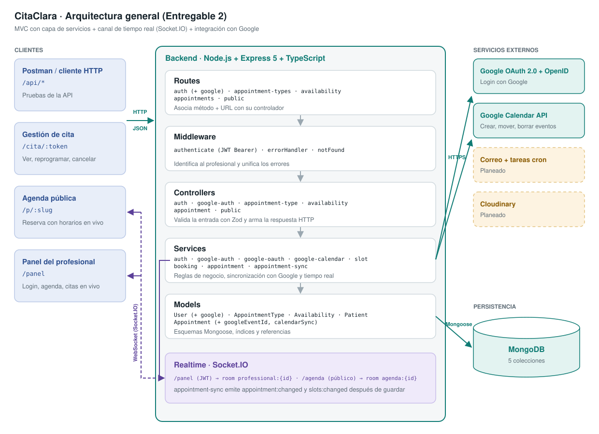
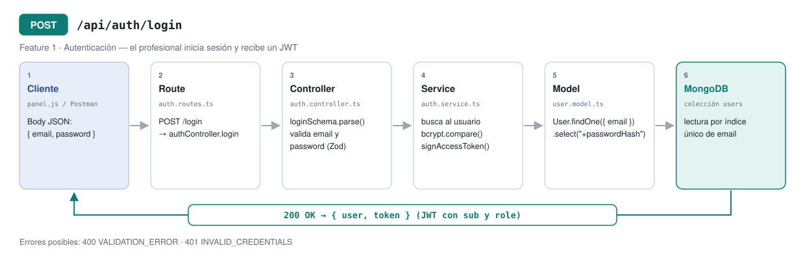
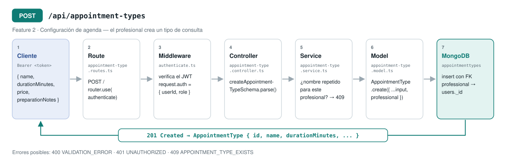
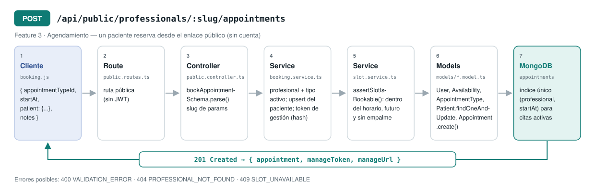
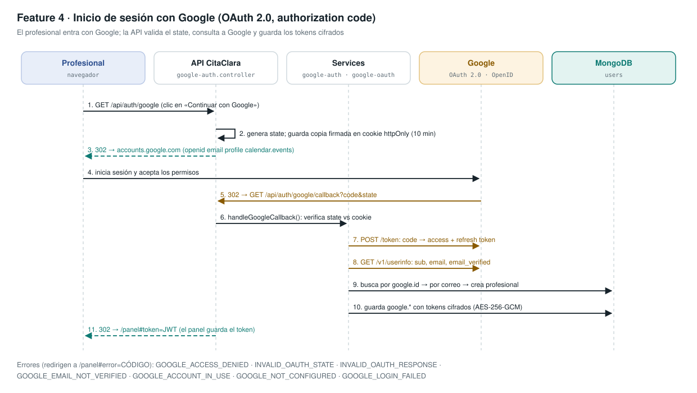
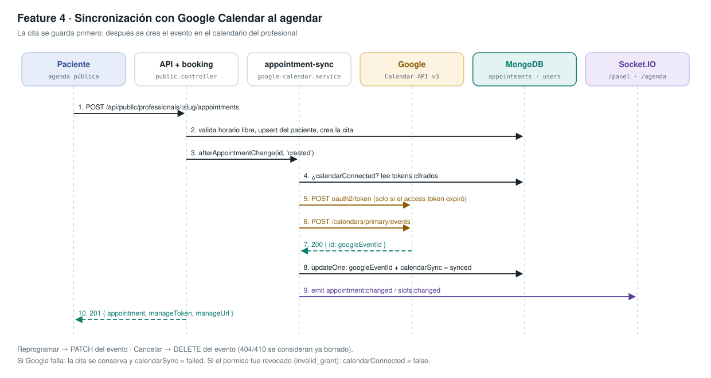
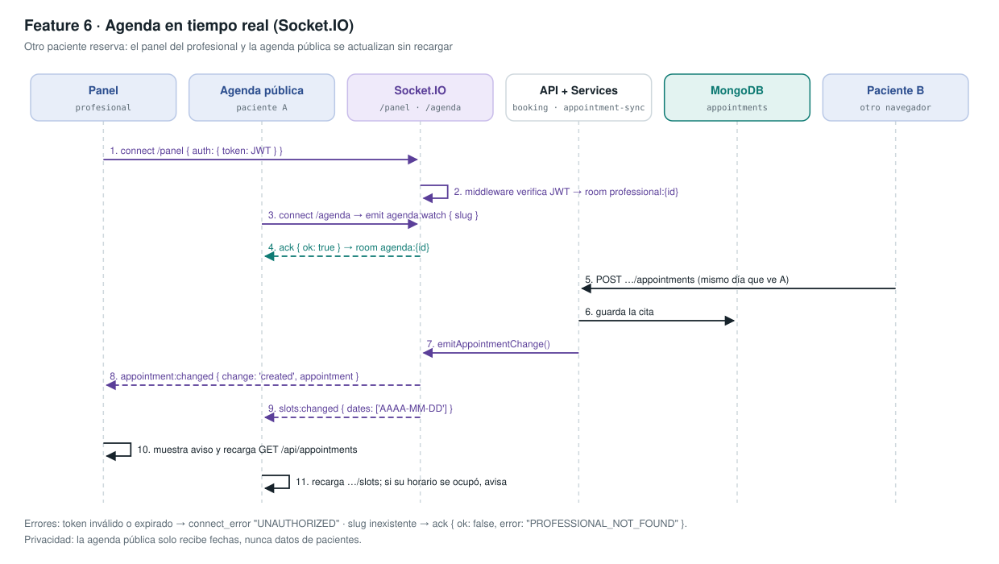

# CitaClara

API de agenda en línea para profesionales de la salud. El profesional comparte un enlace
(por WhatsApp, redes, etc.) y sus pacientes eligen un horario libre y agendan sin crear cuenta.
Después pueden consultar, reprogramar o cancelar su cita desde un enlace privado. Las citas se
sincronizan con el Google Calendar del profesional y su panel se actualiza en tiempo real.

Proyecto integrador de **Tecnologías de Desarrollo en el Servidor** — Entregable 2.

- **Stack:** Node.js 22 · Express 5 · TypeScript · MongoDB + Mongoose · Zod · JWT · Luxon · Socket.IO
- **Arquitectura:** MVC con capa de servicios (`routes → middleware → controllers → services → models`)
  más un canal de tiempo real (Socket.IO) y la integración con las APIs REST de Google.



## Features

| Feature | Estado | Qué permite |
|---|---|---|
| 1. Autenticación de profesionales | Funcional | Registro, inicio de sesión con JWT y perfil (`/api/auth`) |
| 2. Configuración de agenda | Funcional | CRUD de tipos de consulta y de bloques de horario semanal |
| 3. Agendamiento de citas | Funcional | Agenda pública, cálculo de horarios libres, reserva, reprogramación, cancelación y estados |
| 4. Google: login y Calendar | Funcional | Inicio de sesión con Google (OAuth 2.0) y creación, cambio y borrado de eventos en Google Calendar |
| 6. Agenda en tiempo real | Funcional | Socket.IO: el panel recibe citas nuevas, reprogramadas y canceladas; la agenda pública actualiza sus horarios |
| 5. Correos y recordatorios | Planeada | Confirmación y recordatorio por correo con tareas programadas |
| 7. Estudios del paciente | Planeada | Archivos del paciente en la nube (Cloudinary) |

## Requisitos

- Node.js 20 o superior
- MongoDB 7+ local, en Docker o en MongoDB Atlas
- Opcional: un cliente OAuth de Google para el login con Google y Google Calendar (ver abajo)

## Instalación y ejecución

```bash
git clone https://github.com/abimaelmillan/citaclara.git
cd citaclara
npm install
cp .env.example .env      # ajusta MONGO_URI y JWT_SECRET si lo necesitas
npm run seed              # crea un profesional demo con tipos de consulta y horarios
npm run dev               # http://localhost:4000
```

Si no tienes MongoDB instalado puedes levantarlo con Docker:

```bash
docker run -d --name citaclara-mongo -p 27017:27017 mongo:7
```

| Script | Descripción |
|---|---|
| `npm run dev` | Servidor en modo desarrollo con recarga automática |
| `npm run build` | Compila TypeScript a `dist/` |
| `npm start` | Ejecuta la versión compilada |
| `npm run seed` | Reinicia los datos del profesional demo |
| `npm run typecheck` | Verifica tipos sin compilar |

### Probar la interfaz

Después de `npm run seed`:

- Panel del profesional: <http://localhost:4000/panel> (las credenciales demo están en `src/scripts/seed.ts`)
- Agenda pública del profesional demo: <http://localhost:4000/p/dr-juan-perez>
- Al agendar se muestra el enlace privado `/cita/:token` para reprogramar o cancelar.
- Tiempo real: abre el panel en una ventana y la agenda pública en otra; al agendar, el panel muestra
  un aviso sin recargar y la agenda quita el horario ocupado.

## Configurar Google (login + Calendar)

Sin estas variables la app funciona igual; solo quedan deshabilitados el botón “Continuar con Google”
y la sincronización con Google Calendar.

1. En [Google Cloud Console](https://console.cloud.google.com/) crea un proyecto.
2. En **APIs y servicios → Biblioteca**, habilita **Google Calendar API**.
3. En **Google Auth Platform** (pantalla de consentimiento) configura la app como **Externa** y agrega
   tu correo en **Usuarios de prueba**.
4. En **Clientes**, crea un cliente OAuth de tipo **Aplicación web** con el URI de redireccionamiento
   `http://localhost:4000/api/auth/google/callback`.
5. Copia el ID y el secreto del cliente en `.env` (`GOOGLE_CLIENT_ID` y `GOOGLE_CLIENT_SECRET`) y reinicia el servidor.

En el panel puedes entrar con **Continuar con Google** o, si ya tienes cuenta con contraseña, usar
**Conectar Google Calendar**. Mientras la app de Google esté en modo de prueba, Google muestra el aviso
“Google no verificó esta app” y los permisos caducan a los 7 días; después basta con volver a conectar.

## Variables de entorno

| Variable | Descripción | Ejemplo |
|---|---|---|
| `PORT` | Puerto HTTP | `4000` |
| `NODE_ENV` | Ambiente | `development` |
| `MONGO_URI` | Cadena de conexión a MongoDB | `mongodb://localhost:27017/citaclara` |
| `JWT_SECRET` | Secreto para firmar los tokens (también deriva la llave que cifra los tokens de Google) | cadena larga y aleatoria |
| `JWT_TTL` | Vigencia del token | `8h` |
| `APP_URL` | URL pública, se usa en los enlaces de gestión de cita y en las redirecciones de Google | `http://localhost:4000` |
| `DEFAULT_TIMEZONE` | Zona horaria por defecto del profesional | `America/Mexico_City` |
| `GOOGLE_CLIENT_ID` | ID del cliente OAuth de Google (opcional) | `xxxx.apps.googleusercontent.com` |
| `GOOGLE_CLIENT_SECRET` | Secreto del cliente OAuth de Google (opcional) | — |
| `GOOGLE_REDIRECT_URI` | URI de regreso registrada en Google | `http://localhost:4000/api/auth/google/callback` |

En desarrollo, si no existe `.env`, la app usa `.env.example`. En producción las variables son obligatorias.

## Estructura

```
src/
├── app.ts                 # Configuración de Express y registro de rutas
├── server.ts              # Servidor HTTP + Socket.IO y conexión a MongoDB
├── config/                # Variables de entorno, base de datos y constantes de Google
├── routes/                # Método + URL → controlador
├── middleware/            # Autenticación JWT y manejo de errores
├── controllers/           # Validación de entrada (Zod) y respuesta HTTP
├── services/              # Lógica de negocio, Google OAuth/Calendar y sincronización
├── realtime/              # Socket.IO: namespaces /panel y /agenda y emisión de eventos
├── models/                # Esquemas de Mongoose
├── validators/            # Esquemas Zod de cada recurso
├── utils/                 # JWT, contraseñas, cifrado, cookies, slug, tokens de gestión
├── scripts/seed.ts        # Datos de demostración
└── public/                # Interfaz web sencilla (panel, agenda pública, gestión de cita)
```

## API

Todas las respuestas son JSON. Los errores tienen la forma
`{ "error": { "code": "SLOT_UNAVAILABLE", "message": "..." } }`.
Las rutas marcadas con 🔒 requieren el header `Authorization: Bearer <token>`.

| Método | Endpoint | Descripción |
|---|---|---|
| GET | `/api/health` | Estado del servidor y de la base de datos |
| POST | `/api/auth/register` | Crear cuenta de profesional |
| POST | `/api/auth/login` | Iniciar sesión y obtener token |
| GET 🔒 | `/api/auth/me` | Perfil del profesional autenticado (incluye el estado de Google) |
| GET | `/api/auth/google` | Inicia el login con Google (redirige a Google) |
| POST 🔒 | `/api/auth/google/link` | Devuelve la URL para conectar Google Calendar a la cuenta actual |
| GET | `/api/auth/google/callback` | Regreso de Google: crea o vincula la cuenta y redirige a `/panel#token=` |
| GET 🔒 | `/api/appointment-types` | Listar tipos de consulta |
| POST 🔒 | `/api/appointment-types` | Crear tipo de consulta |
| GET 🔒 | `/api/appointment-types/:id` | Consultar un tipo de consulta |
| PATCH 🔒 | `/api/appointment-types/:id` | Actualizar (incluye activar/desactivar) |
| DELETE 🔒 | `/api/appointment-types/:id` | Borrar (solo si no tiene citas) |
| GET 🔒 | `/api/availability` | Listar bloques de horario semanal |
| POST 🔒 | `/api/availability` | Crear bloque (`dayOfWeek` 1 = lunes … 7 = domingo) |
| GET 🔒 | `/api/availability/:id` | Consultar bloque |
| PATCH 🔒 | `/api/availability/:id` | Actualizar bloque |
| DELETE 🔒 | `/api/availability/:id` | Borrar bloque |
| GET | `/api/public/professionals/:slug` | Perfil público y tipos de consulta activos |
| GET | `/api/public/professionals/:slug/slots?appointmentTypeId=&date=AAAA-MM-DD` | Horarios libres de un día |
| POST | `/api/public/professionals/:slug/appointments` | Agendar cita (crea el evento en Google Calendar si está conectado) |
| GET | `/api/public/appointments/:token` | Consultar mi cita |
| PATCH | `/api/public/appointments/:token/reschedule` | Reprogramar mi cita (mueve el evento) |
| PATCH | `/api/public/appointments/:token/cancel` | Cancelar mi cita (borra el evento) |
| GET 🔒 | `/api/appointments?from=&to=&status=` | Citas del profesional (incluye `calendarSync`) |
| GET 🔒 | `/api/appointments/:id` | Detalle de una cita |
| PATCH 🔒 | `/api/appointments/:id/status` | Marcar como atendida, inasistencia o cancelada |

Los errores del login con Google regresan al panel como `/panel#error=CÓDIGO`:
`GOOGLE_NOT_CONFIGURED`, `GOOGLE_ACCESS_DENIED`, `INVALID_OAUTH_STATE`, `INVALID_OAUTH_RESPONSE`,
`GOOGLE_EMAIL_NOT_VERIFIED`, `GOOGLE_ACCOUNT_IN_USE` y `GOOGLE_LOGIN_FAILED`.

### Ejemplo: agendar una cita

```http
POST /api/public/professionals/dr-juan-perez/appointments
Content-Type: application/json

{
  "appointmentTypeId": "6ad57ca9f3f610bc40ef4c52",
  "startAt": "2026-11-18T11:00:00.000-06:00",
  "patient": { "name": "Carlos Ramírez", "email": "carlos@example.com", "phone": "3398765432" },
  "notes": "Hernia inguinal"
}
```

Respuesta `201 Created`: `{ appointment, manageToken, manageUrl }`. Si el horario ya fue tomado
responde `409 SLOT_UNAVAILABLE`. `appointment.calendarSync.status` indica si el evento quedó en
Google Calendar (`synced`), si falló (`failed`) o si el profesional no tiene Calendar conectado (`skipped`).

## Tiempo real (Socket.IO)

El cliente de Socket.IO se sirve en `/socket.io/socket.io.js`.

| Namespace | Quién se conecta | Cómo | Evento que recibe |
|---|---|---|---|
| `/panel` | Profesional | `io('/panel', { auth: { token } })` (JWT obligatorio) | `appointment:changed` → `{ change, appointment }` con `change` = `created`, `rescheduled`, `cancelled`, `completed` o `no_show` |
| `/agenda` | Paciente (sin cuenta) | `io('/agenda')` y `emit('agenda:watch', { slug }, ack)` | `slots:changed` → `{ dates: ['AAAA-MM-DD'] }` (sin datos de pacientes) |

Errores: un token inválido produce `connect_error` con el mensaje `UNAUTHORIZED`; un slug inexistente
responde el ack `{ ok: false, error: 'PROFESSIONAL_NOT_FOUND' }`.

## Diagramas de requests







