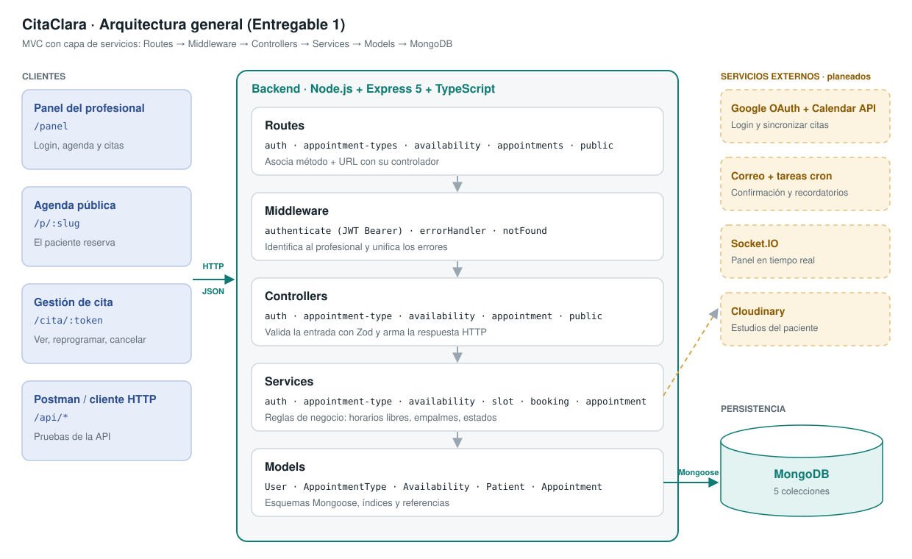
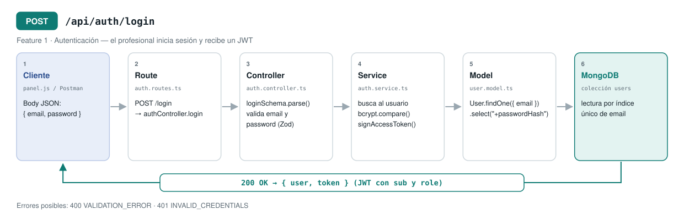
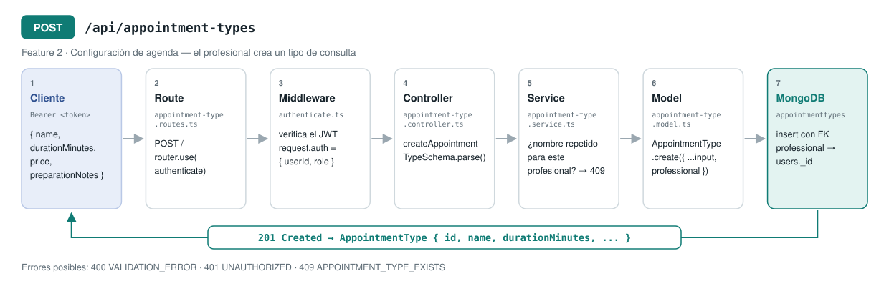
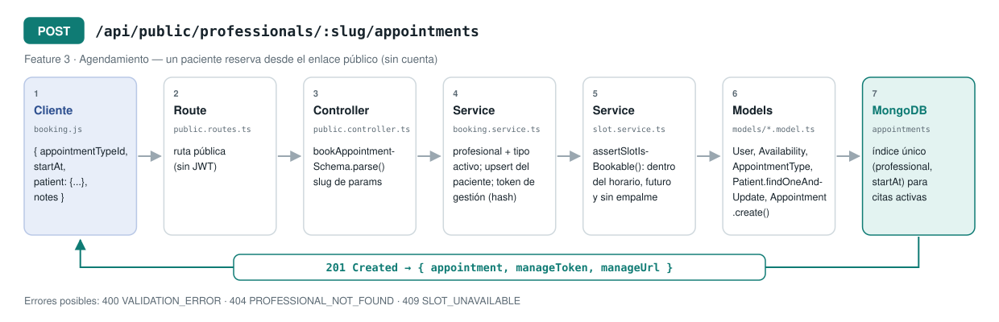

# CitaClara

API de agenda en línea para profesionales de la salud. El profesional comparte un enlace
(por WhatsApp, redes, etc.) y sus pacientes eligen un horario libre y agendan sin crear cuenta.
Después pueden consultar, reprogramar o cancelar su cita desde un enlace privado.

Proyecto integrador de **Tecnologías de Desarrollo en el Servidor** — Entregable 1.

- **Stack:** Node.js 22 · Express 5 · TypeScript · MongoDB + Mongoose · Zod · JWT · Luxon
- **Arquitectura:** MVC con capa de servicios (`routes → middleware → controllers → services → models`)



## Features de esta entrega

| Feature | Estado | Qué permite |
|---|---|---|
| Autenticación de profesionales | Funcional | Registro, inicio de sesión con JWT y perfil (`/api/auth`) |
| Configuración de agenda | Funcional | CRUD de tipos de consulta y de bloques de horario semanal |
| Agendamiento de citas | Funcional | Agenda pública, cálculo de horarios libres, reserva, reprogramación, cancelación y estados |

Planeadas para siguientes entregas: login con Google y sincronización con Google Calendar,
recordatorios por correo con tareas programadas, panel en tiempo real con Socket.IO y carga de
estudios del paciente a la nube.

## Requisitos

- Node.js 20 o superior
- MongoDB 7+ local, en Docker o en MongoDB Atlas

## Instalación y ejecución

```bash
git clone https://github.com/abimaelmillan/citaclara.git
cd citaclara
npm install
cp .env.example .env      # ajusta MONGO_URI y JWT_SECRET si lo necesitas
npm run seed              # crea un profesional demo con tipos de consulta y horarios
npm run dev               # http://localhost:4000
```

Si no tienes MongoDB instalado puedes levantarlo con Docker:

```bash
docker run -d --name citaclara-mongo -p 27017:27017 mongo:7
```

| Script | Descripción |
|---|---|
| `npm run dev` | Servidor en modo desarrollo con recarga automática |
| `npm run build` | Compila TypeScript a `dist/` |
| `npm start` | Ejecuta la versión compilada |
| `npm run seed` | Reinicia los datos del profesional demo |
| `npm run typecheck` | Verifica tipos sin compilar |

### Probar la interfaz

Después de `npm run seed`:

- Panel del profesional: <http://localhost:4000/panel> (las credenciales demo están en `src/scripts/seed.ts`)
- Agenda pública del profesional demo: <http://localhost:4000/p/dr-juan-perez>
- Al agendar se muestra el enlace privado `/cita/:token` para reprogramar o cancelar.

## Variables de entorno

| Variable | Descripción | Ejemplo |
|---|---|---|
| `PORT` | Puerto HTTP | `4000` |
| `NODE_ENV` | Ambiente | `development` |
| `MONGO_URI` | Cadena de conexión a MongoDB | `mongodb://localhost:27017/citaclara` |
| `JWT_SECRET` | Secreto para firmar los tokens | cadena larga y aleatoria |
| `JWT_TTL` | Vigencia del token | `8h` |
| `APP_URL` | URL pública, se usa en los enlaces de gestión de cita | `http://localhost:4000` |
| `DEFAULT_TIMEZONE` | Zona horaria por defecto del profesional | `America/Mexico_City` |

En desarrollo, si no existe `.env`, la app usa `.env.example`. En producción las variables son obligatorias.

## Estructura

```
src/
├── app.ts                 # Configuración de Express y registro de rutas
├── server.ts              # Conexión a MongoDB y arranque del servidor
├── config/                # Variables de entorno y conexión a la base de datos
├── routes/                # Método + URL → controlador
├── middleware/            # Autenticación JWT y manejo de errores
├── controllers/           # Validación de entrada (Zod) y respuesta HTTP
├── services/              # Lógica de negocio (horarios libres, reservas, estados)
├── models/                # Esquemas de Mongoose
├── validators/            # Esquemas Zod de cada recurso
├── utils/                 # JWT, contraseñas, slug, tokens de gestión
├── scripts/seed.ts        # Datos de demostración
└── public/                # Interfaz web mínima (panel, agenda pública, gestión de cita)
```

## API

Todas las respuestas son JSON. Los errores tienen la forma
`{ "error": { "code": "SLOT_UNAVAILABLE", "message": "..." } }`.
Las rutas marcadas con 🔒 requieren el header `Authorization: Bearer <token>`.

| Método | Endpoint | Descripción |
|---|---|---|
| GET | `/api/health` | Estado del servidor y de la base de datos |
| POST | `/api/auth/register` | Crear cuenta de profesional |
| POST | `/api/auth/login` | Iniciar sesión y obtener token |
| GET 🔒 | `/api/auth/me` | Perfil del profesional autenticado |
| GET 🔒 | `/api/appointment-types` | Listar tipos de consulta |
| POST 🔒 | `/api/appointment-types` | Crear tipo de consulta |
| GET 🔒 | `/api/appointment-types/:id` | Consultar un tipo de consulta |
| PATCH 🔒 | `/api/appointment-types/:id` | Actualizar (incluye activar/desactivar) |
| DELETE 🔒 | `/api/appointment-types/:id` | Borrar (solo si no tiene citas) |
| GET 🔒 | `/api/availability` | Listar bloques de horario semanal |
| POST 🔒 | `/api/availability` | Crear bloque (`dayOfWeek` 1 = lunes … 7 = domingo) |
| GET 🔒 | `/api/availability/:id` | Consultar bloque |
| PATCH 🔒 | `/api/availability/:id` | Actualizar bloque |
| DELETE 🔒 | `/api/availability/:id` | Borrar bloque |
| GET | `/api/public/professionals/:slug` | Perfil público y tipos de consulta activos |
| GET | `/api/public/professionals/:slug/slots?appointmentTypeId=&date=AAAA-MM-DD` | Horarios libres de un día |
| POST | `/api/public/professionals/:slug/appointments` | Agendar cita |
| GET | `/api/public/appointments/:token` | Consultar mi cita |
| PATCH | `/api/public/appointments/:token/reschedule` | Reprogramar mi cita |
| PATCH | `/api/public/appointments/:token/cancel` | Cancelar mi cita |
| GET 🔒 | `/api/appointments?from=&to=&status=` | Citas del profesional |
| GET 🔒 | `/api/appointments/:id` | Detalle de una cita |
| PATCH 🔒 | `/api/appointments/:id/status` | Marcar como atendida, inasistencia o cancelada |

### Ejemplo: agendar una cita

```http
POST /api/public/professionals/dr-juan-perez/appointments
Content-Type: application/json

{
  "appointmentTypeId": "6ad57ca9f3f610bc40ef4c52",
  "startAt": "2026-10-19T11:00:00.000-06:00",
  "patient": { "name": "Carlos Ramírez", "email": "carlos@example.com", "phone": "3398765432" },
  "notes": "Hernia inguinal"
}
```

Respuesta `201 Created`: `{ appointment, manageToken, manageUrl }`. Si el horario ya fue tomado
responde `409 SLOT_UNAVAILABLE`.

## Diagramas de requests




